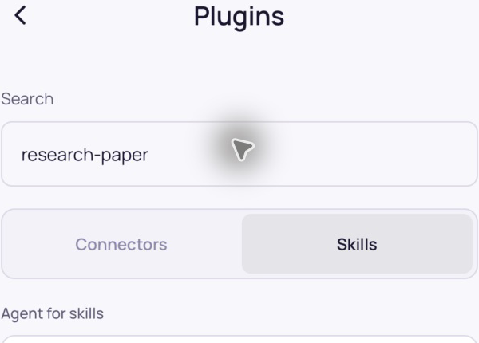
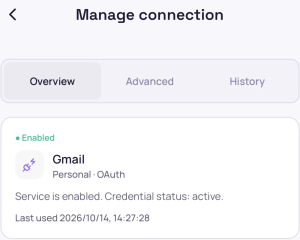
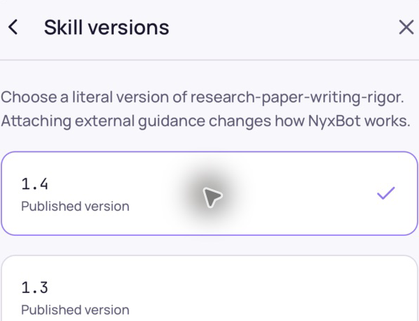
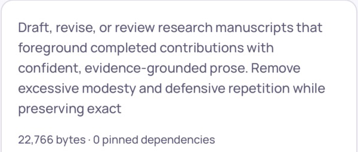
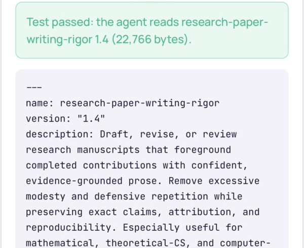
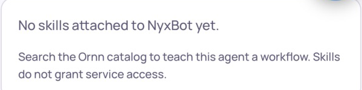

# RN Plugins — implementation and actual iOS verification

Date: 2026-10-14. Frontend only; Machines excluded. Reference: [approved Figma](https://www.figma.com/design/1cxfGMnsqcwgxwxUWyTFrI), its Plugins / Skills / Skill details / Skill versions / Manage connection screens, and current Web Plugins and Agent Skills contracts. Native components reuse the existing theme, authenticated transport and service connection form.

## Delivered paths

- Drawer → Plugins → Connectors / Skills, with a shared search field. Connectors shows Added and Available to add together. Real `/keys` and `/catalog` reads group by canonical catalog identity while preserving every personal/organization credential. Disabled connections remain Added. Failed connection reads suppress Available rather than offering duplicates.
- Added connector → one connection's management page, or a chooser when multiple connections exist. Available connector → existing native credential / token-exchange / platform-key / managed OAuth form. Native Back and Cancel return to the preceding Plugins state.
- Manage connection → Overview / Advanced / History. Overview shows actual connection status and last use, collapsed saved scopes, existing enable/reauthorize/replace/remove controls and ownership restrictions. History reads grouped authorship and metadata, filters server-advertised actions, paginates by cursor, and supports retained history independently of a live connection. Credentials are omitted.
- Plugins → Skills, or Agents → Agent skills: explicit agent selection, current pins, Ornn search and browse pagination, detail, literal-version selection and verified package metadata. Attach / replace / enable / detach use the agent's current selection and `expected_revision`; exact ID/version/digest must match, unrelated pins and dependency metadata survive, and disabled skills are not implicitly enabled.
- Skill detail → read the agent's fixed package / skill history / editable draft. Draft validation and save use the server contracts. Returning to a confirmation loads its exact acknowledgement even outside the recent-card window. Native owner review shows complete draft files and only server-advertised actions; changed, unknown, terminal and uncertain states cannot invent a publication retry. Losing account, focus, permission, foreground or network state during validation prevents the subsequent save.

## Explicit Web handoffs

Advanced routing/connection configuration, OAuth scope editing, specialized device-code/BYO OAuth/SSH setup, and full Studio services/Agent Keys remain Web flows. Buttons name Web/browser explicitly and target the configured HTTPS frontend: a specific `/keys/{connection id}?tab=advanced` or `?tab=overview`, `/keys?slug=...` for setup, and `/keys` for Studio. The Agent Key login screen is not presented as key management. No native advanced editor or completed provider authorization is claimed.

## Actual native operation

Used the existing signed-in iPhone 16e iOS 26.3.1 Simulator, official Expo Go 55.0.34, the existing Metro project on port 8083, and unchanged production API/frontend origins. No mock transport, account switch, login replacement or backend change was used in this batch. Native actions and observations used the existing Simulator window through computer use.

| Operated path                                                                | Observed result                                                                                                                                                                                                                        |
| ---------------------------------------------------------------------------- | -------------------------------------------------------------------------------------------------------------------------------------------------------------------------------------------------------------------------------------- |
| Drawer → Plugins; connector lists and search                                 | Actual Added and Available loaded; no-auth label is readable; actual duplicate personal/organization connections remain grouped.                                                                                                       |
| Multiple connections → chooser → personal management → Back → chooser → Back | Returned through the expected local and native route history.                                                                                                                                                                          |
| Skills agent picker                                                          | Actual NyxBot and specialist options loaded; selecting a specialist showed that agent's actual attached state.                                                                                                                         |
| Browse catalog → page 2; search `research-paper`                             | Real Ornn results and pagination loaded.                                                                                                                                                                                               |
| Skill detail → versions → select 1.4                                         | Actual versions 1.4–1.0 appeared; server preview reported 22,766 bytes and zero dependencies. Attach became available after preview verification.                                                                                      |
| Native Attach → current skill readback                                       | `research-paper-writing-rigor` 1.4 was attached temporarily to NyxBot, whose original list was empty. Detail showed the current fixed version and actual package size.                                                                 |
| Read pinned package                                                          | Server returned `readable=true`, the same 1.4 package and its real excerpt; native UI displayed Test passed. This checks package access, not an assistant execution.                                                                   |
| Skill history                                                                | Actual attachment revision/history appeared.                                                                                                                                                                                           |
| Confirm detach → refreshed attached list                                     | Temporary pin was removed; NyxBot returned to the original empty attached list. The real audit history/revision necessarily records the verification writes. No service grants or credentials changed.                                 |
| Agents → NyxBot → Agent skills → Back                                        | Opened NyxBot's skills and returned to the same Agent detail.                                                                                                                                                                          |
| Available API-key connector → Add with empty credential → Cancel             | Native validation said “Enter the service credential.” No credential write was dispatched; Cancel returned to Plugins with search preserved.                                                                                           |
| Specialized provider setup → Open Web setup → close → refresh → Back         | Configured Web origin loaded its login page in the separate browser session; closing returned to RN and Back returned to Plugins. Provider setup itself was not completed.                                                             |
| Manage connection Overview → Saved permissions                               | Actual saved OAuth scopes expanded; overview defaulted to collapsed scopes and had one native header.                                                                                                                                  |
| History → expand group → filter Credential replaced → All actions            | Actual create/reauthorize changes appeared, credential values were omitted, filtered empty state appeared, and default filtering restored the group. This account had one history group, so native cursor/load-more was not exercised. |
| Advanced → Open advanced settings in Web → close → Back                      | Configured Web origin loaded its login page and returned to RN. The specific destination URL is verified in source, but authenticated advanced editing was not completed.                                                              |

Live disable/enable of skills was unavailable under this account's feature flags. There was no suitable existing authored draft/confirmation for native end-to-end editor/publication verification. Draft validation/save, renew, publication, uncertain recovery, old-card deep linking and disabled-pin writes are implemented and contract-tested, but not claimed as live mutation passes. This batch also did not submit provider credentials, toggle/remove a real connection, complete OAuth, exercise organization-denied writes, force an offline/background mutation race, or verify Android/release/physical-device behavior.

## Focused local checks

From `mobile`, this exact explicit dependency-related set passed **108/108**:

```sh
./node_modules/.bin/tsx --test \
  src/features/plugins/pluginConnectors.test.ts \
  src/features/plugins/pluginSkillsTypes.test.ts \
  src/features/plugins/authoredSkillReviewState.test.ts \
  src/features/plugins/pluginConnectionHistoryTypes.test.ts \
  src/features/plugins/skillDraftSubmission.test.ts \
  src/features/assistant/assistantHistoryTarget.test.ts \
  src/features/services/serviceContracts.test.ts \
  src/features/agents/agentContracts.test.ts \
  src/features/assistant/assistantState.test.ts \
  src/features/assistant/assistantAgentContext.test.ts \
  src/features/assistant/assistantStream.test.ts \
  src/features/assistant/assistantStreamReader.test.ts \
  src/lib/api/authenticatedTransport.test.ts
```

Repository-root commands:

```sh
python3 /Users/abigaildeng/.codex/skills/frontend-incremental-pr/scripts/frontend_change_scope.py --repo . --base 5a5e2f48 > /tmp/nyxid-plugins-scope.json
node mobile/docs/qa/2026-10-14-plugins/check-source.cjs
```

The syntax/import script used TypeScript `transpileModule`, `preProcessFile` and project-configured `resolveModuleName` on the 31 explicitly selected task source/test files; all passed. This is **not semantic typecheck**. Prettier checked the same task manifest, excluding `App.tsx` and `http.ts` to avoid whole-file reformatting of pre-existing styles. Their changed lines were reviewed and included in syntax/import checks. The preserved [task manifest](qa/2026-10-14-plugins/task-files.json) and [syntax/import script](qa/2026-10-14-plugins/check-source.cjs) make this scope reproducible. Formatting was invoked from the repository root with:

```sh
python3 - <<'PY'
import json, subprocess
from pathlib import Path
files = json.loads(Path("mobile/docs/qa/2026-10-14-plugins/task-files.json").read_text())
files = [f for f in files if f.endswith((".ts", ".tsx", ".md", ".cjs", ".json")) and f not in ["mobile/src/app/App.tsx", "mobile/src/lib/api/http.ts"]]
subprocess.run(["frontend/node_modules/.bin/prettier", "--check", *files], check=True)
PY
```

Task-only `git diff --check` passed. No repository-native affected semantic target exists, so full typecheck, frontend suite and production build belong to GitHub CI. No full local command was run.

Independent final source/contract review found and fixed two bugs: live connection 404 no longer gates retained History, and a failed package retest no longer displays an earlier cached success.

## Bounded visual evidence

These are crops of actual native screenshots. They omit account inventories, private transcripts, package identifiers/digests and image metadata. They show specific layouts, not every screen or every mutation. The Expo developer overlay is outside the chosen crops.








